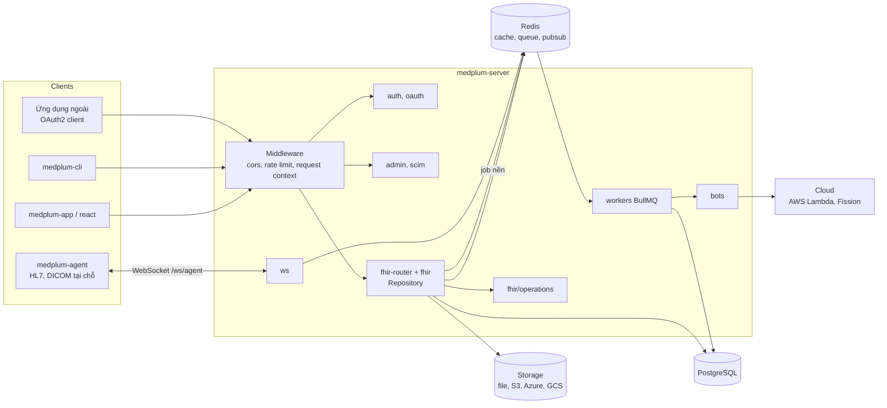
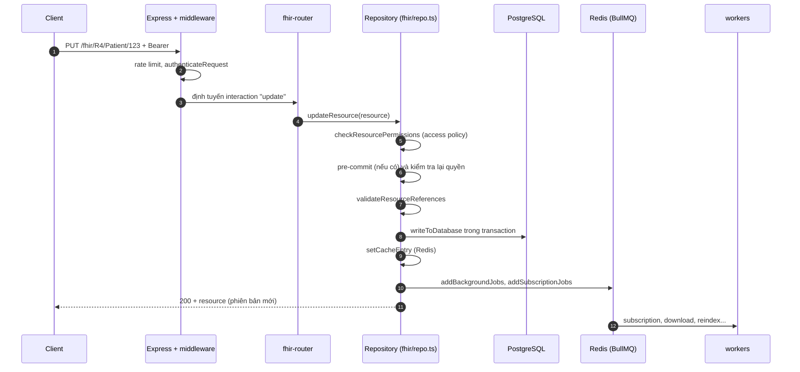
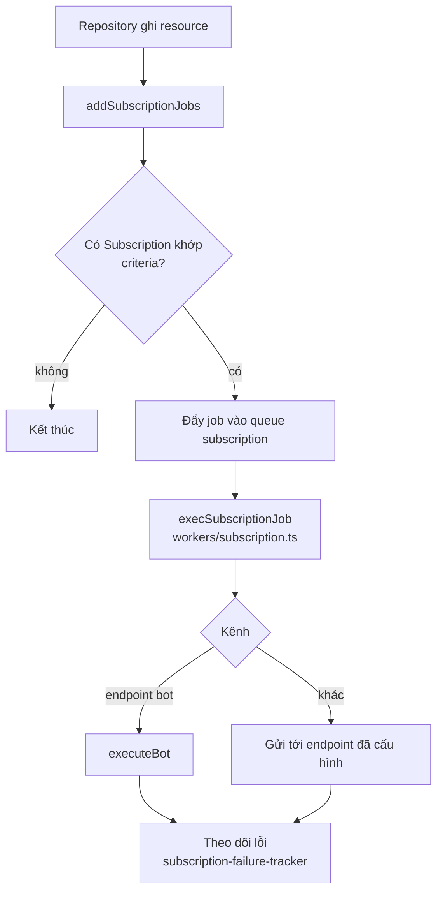
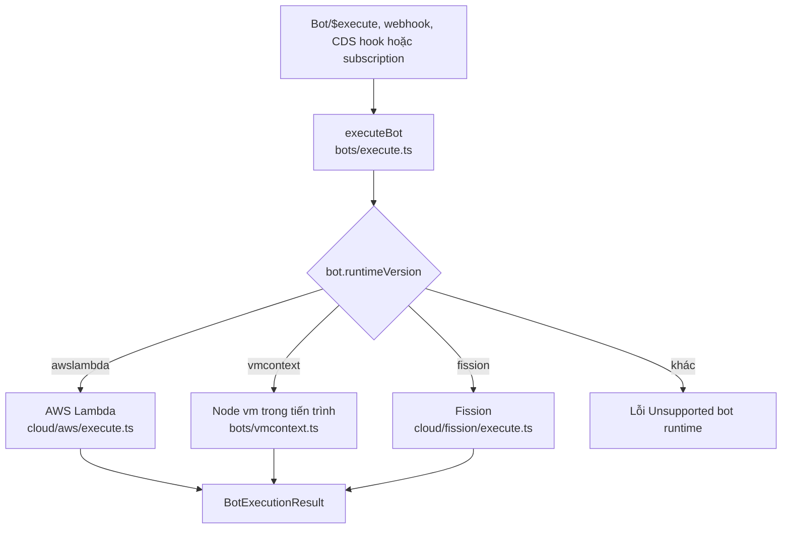
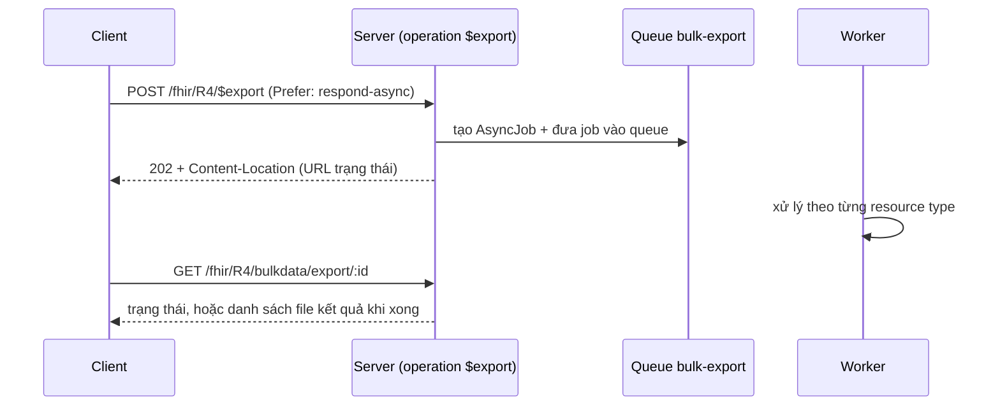
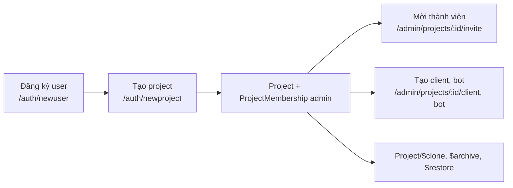
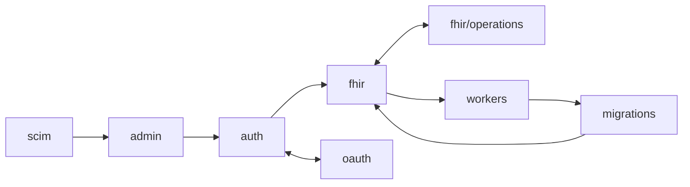

# Business flow

Sơ đồ Mermaid. Mức chi tiết bám theo mã nguồn `medplum/packages/server/src` (tên hàm, tên file được dẫn nguồn). Phần nào chưa đọc sâu được ghi rõ.

## 1. Bức tranh tổng thể

Thứ tự mount router (`app.ts`): `/.well-known`, `/admin`, `/auth`, `/cds-services`, `/email/v1`, `/fhir/R4`, `/fhircast/STU2|STU3`, `/hub`, `/keyvalue/v1`, `/oauth2`, `/scim/v2`, `/shl`, `/webhook`, `/mcp` (tùy cấu hình).

## 2. Ghi một resource (create, update)

Nguồn: `updateResourceImpl`, `writeToDatabase`, `handleStorage` trong `fhir/repo.ts`.

## 3. Subscription kích hoạt bot hoặc thông báo

Ghi chú: các kênh chi tiết (rest-hook, websocket, ...) chưa được đọc sâu; nhánh `F` là mức khái quát.

## 4. Thực thi bot

## 5. Bulk export bất đồng bộ

Nguồn: `fhir/operations/export.ts`, `workers/bulk-export.ts`, `fhir/bulkdata.ts`. Mã trạng thái 202 và header `Content-Location` theo chuẩn FHIR Bulk Data; chưa kiểm chứng từng chi tiết trong mã.

## 6. Vòng đời project (tenant)

## 7. Cụm phụ thuộc cần giữ cùng nhau khi di chuyển

Các mũi tên hai chiều và vòng là lý do `medplum-server` chuyển nguyên khối ở giai đoạn 1.
