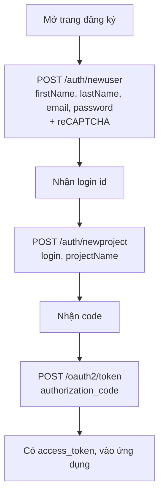
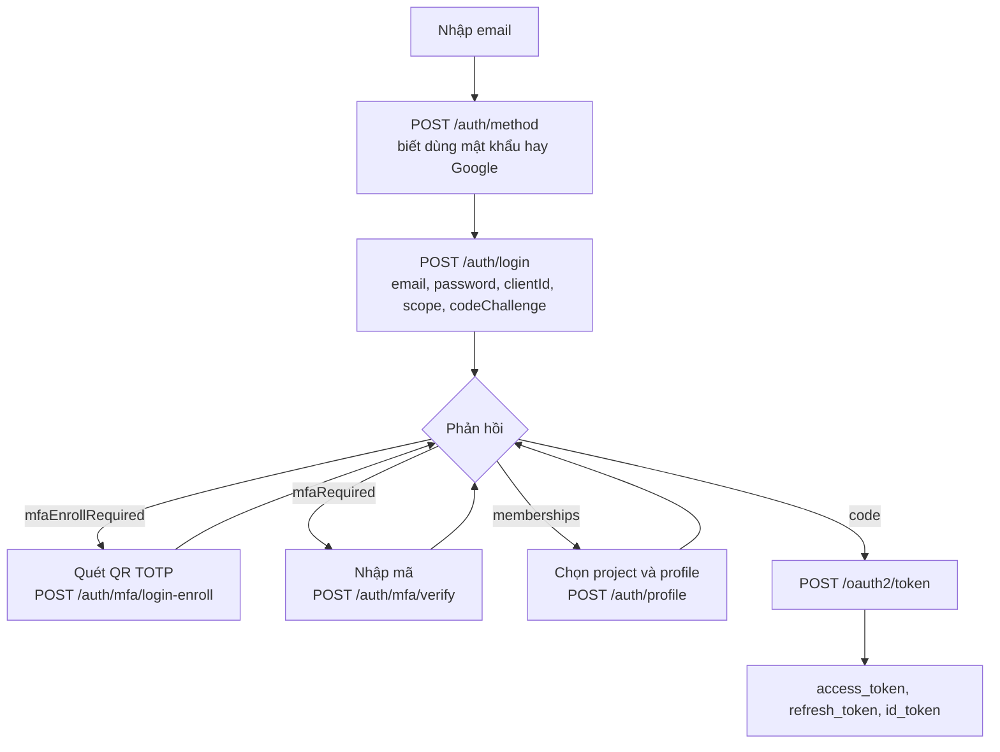
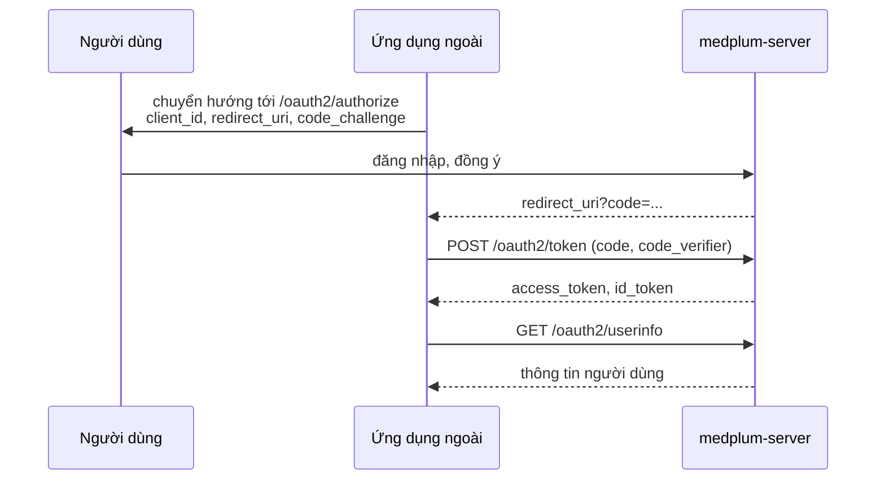
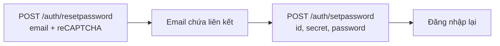
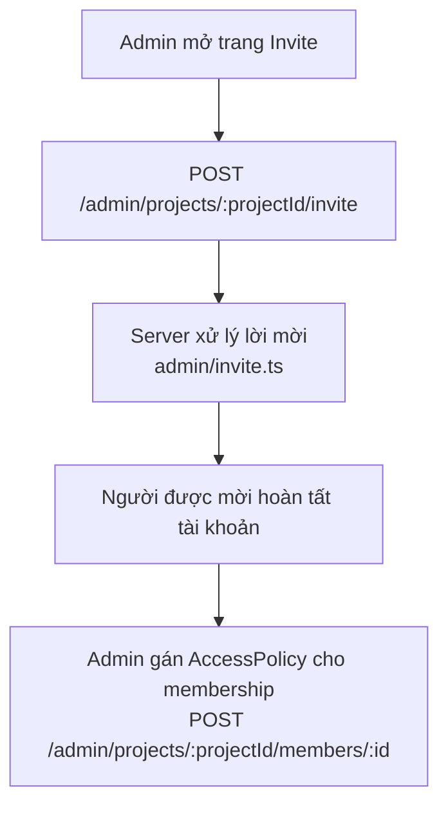
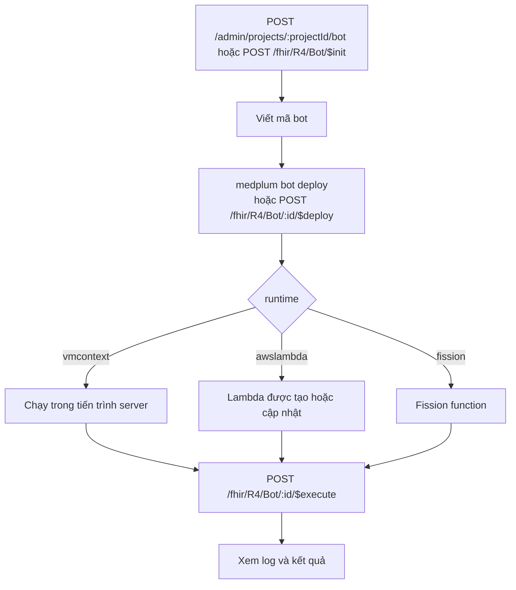
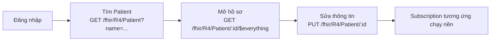
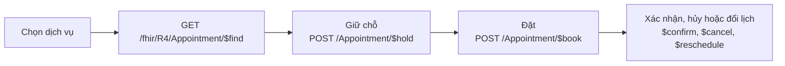
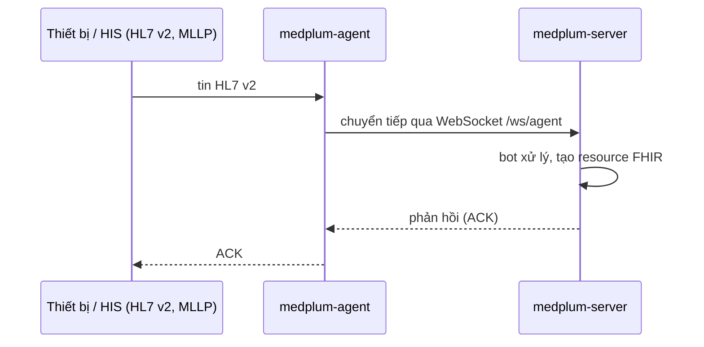
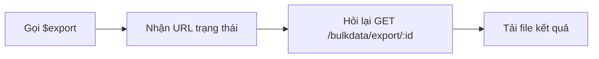

# User flow

Luồng theo góc nhìn người dùng và hệ thống gọi API. Endpoint và dạng phản hồi lấy từ `server/src/auth/*`, `oauth/*`, `admin/*`; xem [api-contract](../api-contract/README.md).

## 1. Đăng ký và tạo project đầu tiên

Ghi chú: đăng ký mở được bật hoặc tắt bằng cấu hình (`projectRegistrationAllowed`), có kiểm tra reCAPTCHA.

## 2. Đăng nhập (mật khẩu, MFA, chọn profile)

Dạng phản hồi chính xác nằm ở [auth.md](../../apps/auth/docs/api-contract/auth.md#luồng-phản-hồi-đăng-nhập).

## 3. Ứng dụng bên thứ ba đăng nhập bằng OAuth2 (authorization code + PKCE)

## 4. Quên mật khẩu

## 5. Quản trị viên mời thành viên và cấp quyền

## 6. Nhà phát triển tạo, triển khai và chạy bot

## 7. Nhân viên y tế tìm và cập nhật bệnh nhân (ứng dụng)

## 8. Đặt lịch hẹn

## 9. Thiết bị tại chỗ gửi tin HL7 v2 qua Agent

Ghi chú: luồng bot trong bước giữa phụ thuộc cấu hình `Agent` và `Endpoint`; sơ đồ là mức khái quát.

## 10. Xuất dữ liệu lớn

