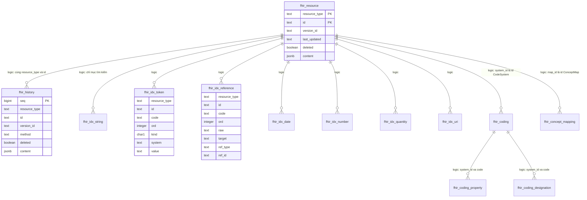
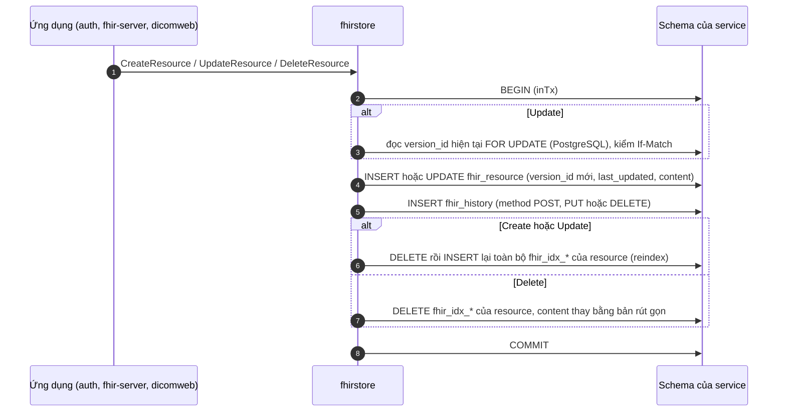

# Bảng vật lý của `pkg/fhirstore` (dùng chung mọi service)

Mọi service lưu dữ liệu FHIR bằng cùng một bộ bảng do `pkg/fhirstore` tạo (migration `pkg/fhirstore/migrations/{postgres,sqlite}/00001..00003`). **Cùng tên bảng ở schema khác là bảng khác**: `auth` có bộ bảng này ở schema `identity`, `fhir-server` và `dicomweb` ở schema `fhir` (mô hình một database nhiều schema, role riêng: [docs/plans/microservices-shared-db.md](../plans/microservices-shared-db.md), `deploy/postgres-init/01-schemas.sh`). Thực thể nghiệp vụ (`User`, `Login`, `Patient`...) **không có bảng riêng**: chúng là JSON trong `fhir_resource.content`. Mô hình logic từng service ở `apps/<svc>/docs/erd/`.

**Nguồn sự thật:** các migration và `pkg/fhirstore/{crud,search,coding,mapping,store}.go`. Danh sách bảng và cột dưới đây được script `introspect_sql.py` đối chiếu (SQLite chạy thật, PostgreSQL phân tích CREATE TABLE) và `check_erd_docs.py` kiểm phủ; hai backend khớp nhau về tập bảng và cột. Chưa kiểm trên một PostgreSQL thật khi viết (xem [mục 6](#6-chưa-kiểm)).

## 1. Sơ đồ

**Không có khóa ngoại nào**; mọi mũi tên là quan hệ *logic*. Toàn vẹn do `pkg/fhirstore` giữ **trong cùng một transaction** (`inTx`): ghi `fhir_resource` + `fhir_history` + xóa-ghi lại `fhir_idx_*`. Test `tests/dbmodel` cấm khóa ngoại chéo schema; trong một schema cũng không có FK nên ghi từ ngoài `fhirstore` (SQL tay) có thể làm lệch chỉ mục.

## 2. Đường ghi dữ liệu

Hệ quả vận hành: (1) **mỗi lần ghi, dù chỉ đổi một trường, sinh một dòng `fhir_history` và ghi lại cả chỉ mục của resource** (ví dụ mỗi lần xoay refresh token của `Login` ở `auth`); (2) `fhir_history` tăng không ngừng, **không có cơ chế dọn tự động** ở `fhirstore`: chỉ `Expunge` xóa lịch sử; (3) xóa resource là **xóa mềm** (xem `fhir_resource.deleted`): các phiên bản cũ vẫn nằm trong `fhir_history`, kể cả trường nhạy cảm của chúng (xem 3.2).

## 3. Bảng lõi

### `fhir_resource`

**Mục đích:** bản **hiện tại** của mỗi resource, một dòng cho mỗi `(resource_type, id)`; là nguồn đọc nhanh (`ReadResource`) và nguồn dựng lại chỉ mục (`Reindex`). **Khóa:** PK `(resource_type, id)`. **Ghi bởi:** `fhirstore.CreateResource`, `UpdateResource`, `DeleteResource`, `Expunge`. **Đọc bởi:** mọi lệnh đọc và tìm kiếm; tìm kiếm nối `fhir_idx_*` với bảng này qua khóa logic. **Vòng đời:** tạo (`INSERT ... ON CONFLICT DO NOTHING`, trùng khóa thì `409` **kể cả khi dòng đã xóa mềm**), sửa (`UPDATE`; resource đã xóa mềm bị `410 Gone`), xóa mềm (`deleted = true`), xóa cứng chỉ bằng `Expunge`. Vì vậy **id đã xóa mềm không dùng lại được** cho tới khi `Expunge`. **Nhạy cảm:** phụ thuộc loại resource (S2 đến S4 ở `identity`, S3 ở `fhir`).

| Cột | Kiểu | Null | Mặc định | Chức năng | Nhạy cảm |
|---|---|---|---|---|---|
| `resource_type` | text | không | | Tên loại resource (`User`, `Login`, `Patient`...); nửa đầu khóa chính; đứng đầu mọi chỉ mục tìm kiếm nên mọi truy vấn đều lọc theo loại trước | S1 |
| `id` | text | không | | Id logic trong phạm vi loại; do `fhirstore` sinh (UUID v4 dạng `8-4-4-4-12` chữ thường) khi tạo không kèm id, hoặc do client chọn khi `PUT` tạo mới (update-as-create); **không duy nhất toàn cục**, chỉ duy nhất trong `(resource_type, id)` | S1 |
| `version_id` | text | không | | Id phiên bản của bản hiện tại (UUID v4 sinh lại ở **mỗi** lần ghi); trùng `meta.versionId` trong `content`; dùng cho `If-Match` (kiểm xung đột phiên bản, `412` khi lệch) và đọc `_history/<vid>` | S1 |
| `last_updated` | text | không | | Thời điểm ghi, chuỗi UTC dạng `2026-11-24T10:15:30.123Z` (mili giây); trùng `meta.lastUpdated`; là **text**, không phải timestamp nên sắp xếp theo chuỗi | S1 |
| `deleted` | boolean | không | `false` | Xóa mềm: `true` thì đọc trả `410 Gone`, tìm kiếm bỏ qua, `Reindex` bỏ qua; `content` khi đó chỉ còn `{resourceType, id, meta}`. Dòng đã xóa mềm không sửa hay tạo lại được (xem vòng đời ở trên) | S1 |
| `content` | jsonb (PostgreSQL), text (SQLite) | không | | Toàn bộ resource dạng JSON (kèm `meta.versionId`, `meta.lastUpdated`); **nơi chứa mọi dữ liệu nghiệp vụ**; `Reindex` đọc từ đây để dựng lại chỉ mục; số được giữ nguyên (không ép float) | S2 đến S4 |

### `fhir_history`

**Mục đích:** nhật ký **mọi phiên bản** của mọi resource (kể cả phiên bản xóa), phục vụ `_history`, đọc theo `vid`, kiểm toán. **Khóa:** PK `seq` (tự tăng, thứ tự toàn cục); `UNIQUE (resource_type, id, version_id)`; chỉ mục `fhir_history_by_resource (resource_type, id, seq)`. **Ghi bởi:** mỗi lần `Create`, `Update`, `Delete` (cùng transaction với `fhir_resource`). **Đọc bởi:** `ReadVersion`, `History`, `Expunge` (đếm). **Vòng đời:** chỉ thêm, **không bao giờ sửa**; chỉ `Expunge` xóa (cùng chỉ mục và dòng `fhir_resource`).

| Cột | Kiểu | Null | Mặc định | Chức năng | Nhạy cảm |
|---|---|---|---|---|---|
| `seq` | bigint, `GENERATED ALWAYS AS IDENTITY` (PostgreSQL) | không | tự tăng | Số thứ tự toàn cục của phiên bản trong schema; dùng sắp xếp lịch sử theo thời gian ghi và phân trang `_history` | S1 |
| `resource_type` | text | không | | Loại resource của phiên bản (khớp `fhir_resource.resource_type`; không có FK) | S1 |
| `id` | text | không | | Id resource của phiên bản (nửa sau khóa logic tới `fhir_resource`) | S1 |
| `version_id` | text | không | | Id phiên bản; cùng `(resource_type, id)` là duy nhất (`UNIQUE`) | S1 |
| `last_updated` | text | không | | Thời điểm ghi phiên bản (cùng định dạng `fhir_resource.last_updated`) | S1 |
| `method` | text | không | | Thao tác sinh ra phiên bản: `POST` (tạo), `PUT` (sửa), `DELETE` (xóa mềm) | S1 |
| `deleted` | boolean | không | | `true` ở phiên bản xóa (`method = DELETE`); phiên bản này có `content` rút gọn | S1 |
| `content` | jsonb (PostgreSQL), text (SQLite) | không | | Bản sao đầy đủ của resource tại phiên bản đó, **kể cả trường nhạy cảm của thời điểm đó** | S2 đến S4 |

## 4. Bảng chỉ mục tìm kiếm `fhir_idx_*`

Bảy bảng cùng khuôn: mỗi dòng là **một giá trị** của **một tham số tìm kiếm** (`code`) của **một resource**; để `GET Type?code=...` không phải quét JSON. **Ghi bởi:** `fhirstore.reindex` (xóa hết dòng của resource trong cả bảy bảng rồi ghi lại, trong cùng transaction với ghi resource; `Reindex` quản trị làm lại hàng loạt theo lô 200 resource). **Xóa:** khi resource bị xóa mềm hoặc `Expunge` (`deleteIndex`); resource xóa mềm **không** có dòng chỉ mục. **Tham số nào được lập chỉ mục:** mọi search parameter của loại (từ `pkg/fhir/searchparams_gen.go`) trừ `_id` (dùng thẳng cột `id`), trừ kiểu `special`; tham số `composite` được ghi theo từng thành phần với `code` dạng `<code>#<i>`. **Quan hệ:** không có FK tới `fhir_resource`; khóa logic `(resource_type, id)`. **Nhạy cảm:** giống dữ liệu của tham số được lập chỉ mục (token `email`, `code` của `Login` là S4 nếu tham số đó là mã xác thực).

Các cột chung của cả bảy bảng:

- `resource_type`, `id`: trỏ tới resource sở hữu dòng (chỉ mục `*_owner` dùng để xóa nhanh khi ghi lại).
- `code`: mã tham số tìm kiếm (`family`, `user`, `identifier`...), đứng sau `resource_type` trong chỉ mục tìm kiếm.
- `ord`: thứ tự của giá trị trong kết quả đánh giá biểu thức tham số (0, 1, 2...); với tham số composite là chỉ số phần tử để các thành phần của cùng phần tử ghép được với nhau (`search.go` nối theo `ord`).

### `fhir_idx_string`

**Mục đích:** tham số kiểu *string* (tên, địa chỉ, mô tả): so khớp tiền tố, chứa, chính xác không phân biệt hoa thường và dấu. **Chỉ mục:** `fhir_idx_string_owner (resource_type, id)`, `fhir_idx_string_search (resource_type, code, norm)`.

| Cột | Kiểu | Null | Mặc định | Chức năng | Nhạy cảm |
|---|---|---|---|---|---|
| `resource_type` | text | không | | Loại resource sở hữu dòng chỉ mục (khóa logic tới `fhir_resource`) | S1 |
| `id` | text | không | | Id resource sở hữu dòng chỉ mục; kèm `resource_type` để xóa-ghi lại cả chỉ mục của một resource | S1 |
| `code` | text | không | | Mã tham số tìm kiếm mà giá trị này phục vụ (ví dụ `family`, `name`) | S1 |
| `ord` | integer | không | | Vị trí của giá trị trong kết quả biểu thức tham số (hoặc chỉ số phần tử khi composite) | S1 |
| `raw` | text | không | | Giá trị gốc đúng như trong resource; dùng cho so khớp chính xác (`:exact`) | S2 |
| `norm` | text | không | | Giá trị đã chuẩn hóa để so sánh: chữ thường, bỏ dấu (NFD bỏ dấu kết hợp, `đ` thành `d`); là cột mà chỉ mục tìm kiếm đánh vào | S2 |

### `fhir_idx_token`

**Mục đích:** tham số kiểu *token* (mã, định danh, trạng thái, boolean, `system|code`). **Chỉ mục:** `fhir_idx_token_owner (resource_type, id)`, `fhir_idx_token_search (resource_type, code, value)`.

| Cột | Kiểu | Null | Mặc định | Chức năng | Nhạy cảm |
|---|---|---|---|---|---|
| `resource_type` | text | không | | Loại resource sở hữu dòng chỉ mục (khóa logic tới `fhir_resource`) | S1 |
| `id` | text | không | | Id resource sở hữu dòng chỉ mục | S1 |
| `code` | text | không | | Mã tham số tìm kiếm (ví dụ `identifier`, `status`, `code`) | S1 |
| `ord` | integer | không | | Vị trí giá trị trong kết quả biểu thức (hoặc chỉ số phần tử composite) | S1 |
| `kind` | char(1) | không | | `'v'`: giá trị token (có hoặc không `system`); `'t'`: văn bản chuẩn hóa dùng cho bộ lọc `:text` (cột `value` là văn bản, `system` rỗng) | S1 |
| `system` | text | có | | Hệ mã (`system` của Coding/Identifier); `NULL` khi giá trị không có system (khác với chuỗi rỗng: phân biệt `|code` với `code`) | S1 |
| `value` | text | không | | Mã hoặc giá trị token (`code` của Coding, `value` của Identifier, `true`/`false` của boolean) hoặc văn bản chuẩn hóa khi `kind = 't'`; cột chỉ mục tìm kiếm đánh vào | S2 đến S4 |

### `fhir_idx_reference`

**Mục đích:** tham số kiểu *reference*: **đây là nơi lưu quan hệ logic giữa các resource ở dạng truy vấn được** (ví dụ tìm mọi `Login` của một `User`). **Chỉ mục:** `fhir_idx_reference_owner (resource_type, id)`, `fhir_idx_reference_search (resource_type, code, target)`.

| Cột | Kiểu | Null | Mặc định | Chức năng | Nhạy cảm |
|---|---|---|---|---|---|
| `resource_type` | text | không | | Loại resource **chứa** tham chiếu (phía "từ" của quan hệ) | S1 |
| `id` | text | không | | Id resource chứa tham chiếu | S1 |
| `code` | text | không | | Mã tham số tìm kiếm của tham chiếu (ví dụ `user`, `project`, `subject`) | S1 |
| `ord` | integer | không | | Vị trí tham chiếu trong kết quả biểu thức (một tham số có thể có nhiều tham chiếu) | S1 |
| `raw` | text | không | | Chuỗi tham chiếu đúng như trong resource (`User/abc`, URL tuyệt đối, `urn:uuid:...`); dùng khi tìm theo giá trị gốc | S1 |
| `target` | text | không | | Tham chiếu đã chuẩn hóa dạng `Type/id` (bỏ `_history` và tiền tố URL); **cột chính để tìm** `?user=User/abc`; giữ nguyên `urn:` và `#` | S1 |
| `ref_type` | text | không | | Loại đích tách từ `target` ở dấu `/` cuối (`User`); rỗng nếu `target` không có dạng `Type/id` | S1 |
| `ref_id` | text | không | | Id đích tách từ `target` (`abc`); để tìm theo id trần (`?user=abc`) kèm tập loại đích hợp lệ | S1 |

### `fhir_idx_date`

**Mục đích:** tham số kiểu *date* (ngày, thời điểm, khoảng). Mỗi giá trị được lưu là **khoảng nửa mở `[lo, hi)`** nên một ngày `2026-01-02` và một thời điểm đều so sánh được theo các tiền tố `eq`, `gt`, `lt`, `sa`, `eb`. **Chỉ mục:** `fhir_idx_date_owner (resource_type, id)`, `fhir_idx_date_search (resource_type, code, lo)`.

| Cột | Kiểu | Null | Mặc định | Chức năng | Nhạy cảm |
|---|---|---|---|---|---|
| `resource_type` | text | không | | Loại resource sở hữu dòng chỉ mục (khóa logic tới `fhir_resource`) | S1 |
| `id` | text | không | | Id resource sở hữu dòng chỉ mục | S1 |
| `code` | text | không | | Mã tham số tìm kiếm kiểu date (ví dụ `birthdate`, `authored`) | S1 |
| `ord` | integer | không | | Vị trí giá trị trong kết quả biểu thức (hoặc chỉ số phần tử composite) | S1 |
| `lo` | bigint | không | | Cận dưới của khoảng, **micro giây Unix UTC** (`UnixMicro`); độ chính xác của giá trị gốc quyết định độ rộng khoảng; cột đứng sau `code` trong chỉ mục nên truy vấn khoảng dùng được chỉ mục | S2 |
| `hi` | bigint | không | | Cận trên **loại trừ** của khoảng, micro giây Unix UTC (`hi - lo` bằng độ chính xác của giá trị gốc: một ngày, một giờ...) | S2 |

### `fhir_idx_number`

**Mục đích:** tham số kiểu *number* (số nguyên, số thập phân). **Chỉ mục:** `fhir_idx_number_owner (resource_type, id)`, `fhir_idx_number_search (resource_type, code, value)`.

| Cột | Kiểu | Null | Mặc định | Chức năng | Nhạy cảm |
|---|---|---|---|---|---|
| `resource_type` | text | không | | Loại resource sở hữu dòng chỉ mục (khóa logic tới `fhir_resource`) | S1 |
| `id` | text | không | | Id resource sở hữu dòng chỉ mục | S1 |
| `code` | text | không | | Mã tham số tìm kiếm kiểu number | S1 |
| `ord` | integer | không | | Vị trí giá trị trong kết quả biểu thức (hoặc chỉ số phần tử composite) | S1 |
| `value` | double precision | không | | Giá trị số dùng để so sánh với khoảng ẩn (`NLo`, `NHi`) theo độ chính xác của số tìm; là số thực nên có sai số làm tròn | S1 |

### `fhir_idx_quantity`

**Mục đích:** tham số kiểu *quantity* (số kèm đơn vị, ví dụ kết quả xét nghiệm). **Chỉ mục:** `fhir_idx_quantity_owner (resource_type, id)`, `fhir_idx_quantity_search (resource_type, code, value)`.

| Cột | Kiểu | Null | Mặc định | Chức năng | Nhạy cảm |
|---|---|---|---|---|---|
| `resource_type` | text | không | | Loại resource sở hữu dòng chỉ mục (khóa logic tới `fhir_resource`) | S1 |
| `id` | text | không | | Id resource sở hữu dòng chỉ mục | S1 |
| `code` | text | không | | Mã tham số tìm kiếm kiểu quantity (ví dụ `value-quantity`) | S1 |
| `ord` | integer | không | | Vị trí giá trị trong kết quả biểu thức (hoặc chỉ số phần tử composite) | S1 |
| `value` | double precision | không | | Giá trị số của đại lượng | S3 |
| `system` | text | không | | Hệ đơn vị (ví dụ UCUM `http://unitsofmeasure.org`); rỗng nếu không có | S1 |
| `qcode` | text | không | | Mã đơn vị trong hệ (ví dụ `mg/dL`); tên `qcode` để tránh trùng từ khóa `code` đã dùng cho mã tham số | S1 |
| `unit` | text | không | | Nhãn đơn vị hiển thị (`Quantity.unit`); dùng khi hệ và mã đơn vị trống | S1 |

### `fhir_idx_uri`

**Mục đích:** tham số kiểu *uri* (url của CodeSystem, canonical, địa chỉ). **Chỉ mục:** `fhir_idx_uri_owner (resource_type, id)`, `fhir_idx_uri_search (resource_type, code, value)`.

| Cột | Kiểu | Null | Mặc định | Chức năng | Nhạy cảm |
|---|---|---|---|---|---|
| `resource_type` | text | không | | Loại resource sở hữu dòng chỉ mục (khóa logic tới `fhir_resource`) | S1 |
| `id` | text | không | | Id resource sở hữu dòng chỉ mục | S1 |
| `code` | text | không | | Mã tham số tìm kiếm kiểu uri (ví dụ `url`) | S1 |
| `ord` | integer | không | | Vị trí giá trị trong kết quả biểu thức (hoặc chỉ số phần tử composite) | S1 |
| `value` | text | không | | Giá trị URI đúng như trong resource; cột chỉ mục tìm kiếm đánh vào (so khớp chính xác) | S1 |
| `norm` | text | không | | URI đã chuẩn hóa (chữ thường, bỏ dấu) cho so khớp không phân biệt hoa thường | S1 |

## 5. Bảng dẫn xuất (terminology)

Không nằm trong JSON của resource; khóa theo **id của CodeSystem hoặc ConceptMap** (không có FK; xóa cứng resource cha bằng `Expunge` xóa luôn dòng dẫn xuất). **`auth` không dùng các bảng này** (không lưu CodeSystem hay ConceptMap): chúng tồn tại nhưng **rỗng** ở schema `identity` vì migration tạo chung cho mọi service.

### `fhir_coding`

**Mục đích:** các concept của một CodeSystem để `$lookup`, `$validate-code`, `$expand` không phải quét JSON. **Khóa:** PK `(system_id, code)`. **Ghi bởi:** `PutConcepts` (upsert, `display` cập nhật khi trùng khóa) khi nạp CodeSystem; **xóa bởi** `DeleteConcepts`/`Expunge`.

| Cột | Kiểu | Null | Mặc định | Chức năng | Nhạy cảm |
|---|---|---|---|---|---|
| `system_id` | text | không | | Id của resource CodeSystem sở hữu concept (không phải URL `system`); nửa đầu khóa chính | S1 |
| `code` | text | không | | Mã concept trong hệ mã; nửa sau khóa chính | S1 |
| `display` | text | không | `''` | Tên hiển thị của concept; cập nhật khi nạp lại hệ mã | S1 |

### `fhir_coding_property`

**Mục đích:** thuộc tính của concept (ví dụ `parent`, `status`, `inactive`) phục vụ lọc `$expand` theo thuộc tính. **Khóa:** PK `(system_id, code, property, value)`; chỉ mục `fhir_coding_property_target (system_id, property, value)` để tìm ngược ("mọi concept có parent = X"). **Ghi bởi:** `PutConceptProperties` (yêu cầu concept đã tồn tại: `requireCodes`; `ON CONFLICT DO NOTHING`).

| Cột | Kiểu | Null | Mặc định | Chức năng | Nhạy cảm |
|---|---|---|---|---|---|
| `system_id` | text | không | | Id CodeSystem sở hữu concept; trong khóa chính | S1 |
| `code` | text | không | | Mã concept mang thuộc tính (phải có ở `fhir_coding`, do mã ứng dụng kiểm, không có FK) | S1 |
| `property` | text | không | | Tên thuộc tính (`parent`, `status`...) | S1 |
| `type` | text | không | | Kiểu giá trị của thuộc tính FHIR (`code`, `string`, `boolean`, `Coding`...), quyết định cách hiểu `value` | S1 |
| `value` | text | không | | Giá trị thuộc tính dạng chuỗi; với `parent` là mã concept cha | S1 |

### `fhir_coding_designation`

**Mục đích:** tên gọi thay thế của concept theo ngôn ngữ (đa ngôn ngữ cho `$lookup` và `$expand`). **Khóa:** PK `(system_id, code, language, value)`. **Ghi bởi:** `PutConceptDesignations` (yêu cầu concept tồn tại).

| Cột | Kiểu | Null | Mặc định | Chức năng | Nhạy cảm |
|---|---|---|---|---|---|
| `system_id` | text | không | | Id CodeSystem sở hữu concept; trong khóa chính | S1 |
| `code` | text | không | | Mã concept được đặt tên thay thế | S1 |
| `language` | text | không | `''` | Mã ngôn ngữ BCP-47 của tên gọi (`vi`, `en`); rỗng nếu không khai | S1 |
| `value` | text | không | | Nội dung tên gọi thay thế | S1 |

### `fhir_concept_mapping`

**Mục đích:** các cặp ánh xạ nguồn → đích của một ConceptMap cho `$translate` (không phải quét JSON). **Khóa:** PK `(map_id, source_system, source_code, target_system, target_code)`; chỉ mục `fhir_concept_mapping_target (map_id, target_system, target_code)` để dịch ngược. **Ghi bởi:** `PutMappings` (upsert theo khóa) khi nạp ConceptMap (`conceptmapimport.go`).

| Cột | Kiểu | Null | Mặc định | Chức năng | Nhạy cảm |
|---|---|---|---|---|---|
| `map_id` | text | không | | Id của resource ConceptMap sở hữu ánh xạ; trong khóa chính | S1 |
| `source_system` | text | không | | Hệ mã nguồn (URL) của cặp ánh xạ | S1 |
| `source_code` | text | không | | Mã nguồn được ánh xạ | S1 |
| `source_display` | text | không | `''` | Tên hiển thị của mã nguồn (thông tin kèm, không tham gia khóa) | S1 |
| `target_system` | text | không | | Hệ mã đích (URL) | S1 |
| `target_code` | text | không | | Mã đích tương ứng | S1 |
| `target_display` | text | không | `''` | Tên hiển thị của mã đích | S1 |
| `equivalence` | text | không | `''` | Mức tương đương FHIR (`equivalent`, `wider`, `narrower`, `relatedto`...); trả về trong kết quả `$translate` | S1 |
| `comment` | text | không | `''` | Chú thích của ánh xạ trong ConceptMap | S1 |
| `attributes` | text | không | `''` | Thông tin phụ của ánh xạ dạng chuỗi (ví dụ điều kiện `dependsOn`/`product`), không dùng để tìm kiếm | S1 |

## 6. Chưa kiểm

- Chưa chạy `\d+` và truy vấn `information_schema` trên một PostgreSQL thật khi viết: kiểu cột lấy từ migration PostgreSQL bằng phân tích văn bản (xem `~/.claude/skills/service-erd-docs/references/verify-db.md`).
- Chưa đo kích thước bảng thật; nhận định "`fhir_history` và `fhir_idx_*` lớn nhanh" suy từ đường ghi, chưa có số đo.
- Bảng phiên bản goose **`fhirstore_schema_version`** (hằng `MigrationTable` ở `store.go`) do `pkg/database` tạo lúc migrate, không nằm trong tệp migration: một dòng cho mỗi phiên bản đã chạy (`version_id`, `is_applied`, thời điểm); chưa mô tả từng cột.
